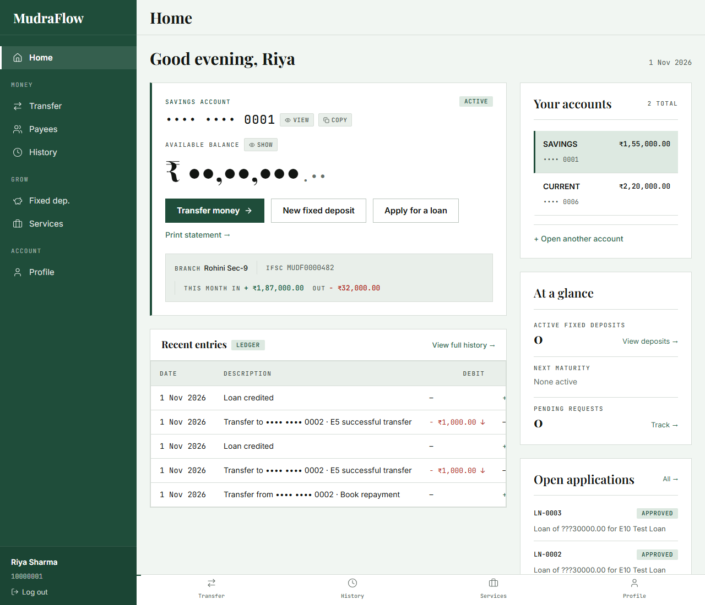
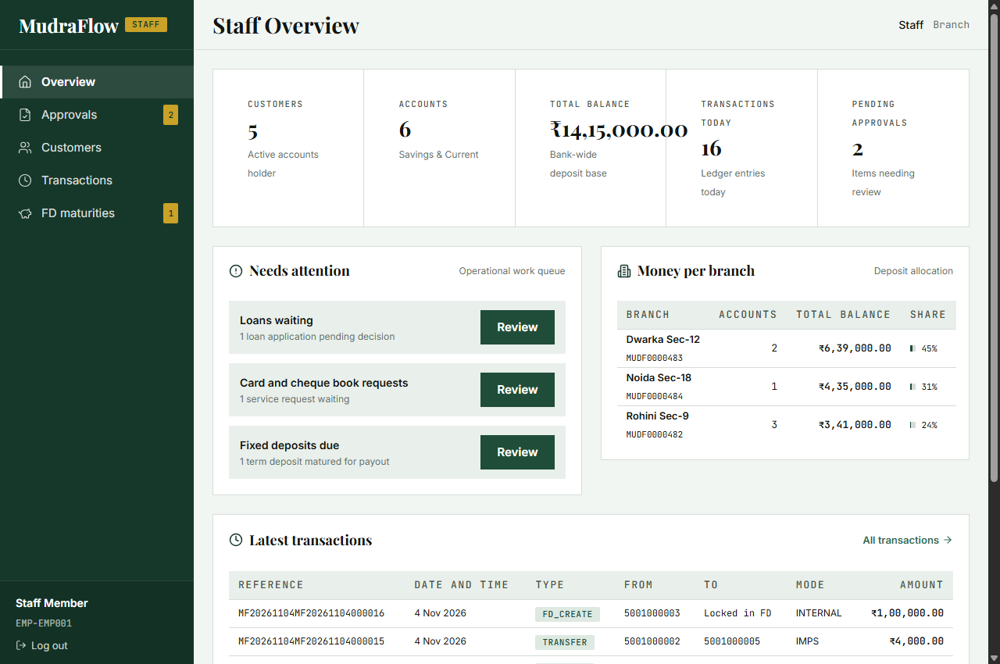
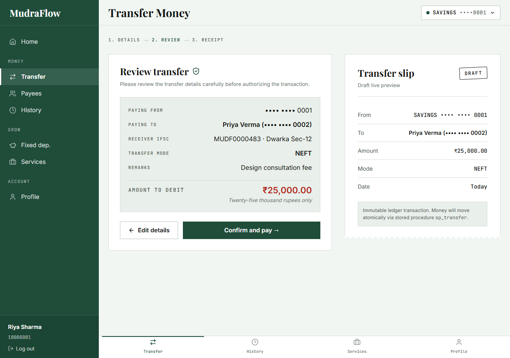
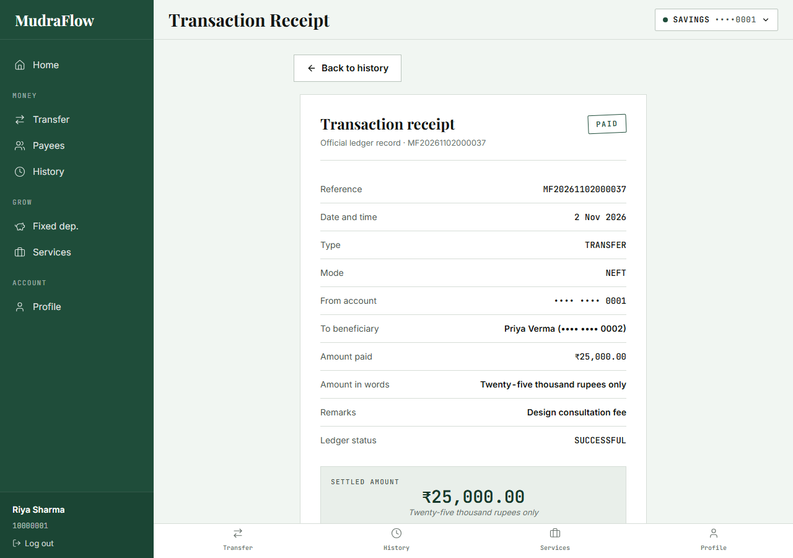
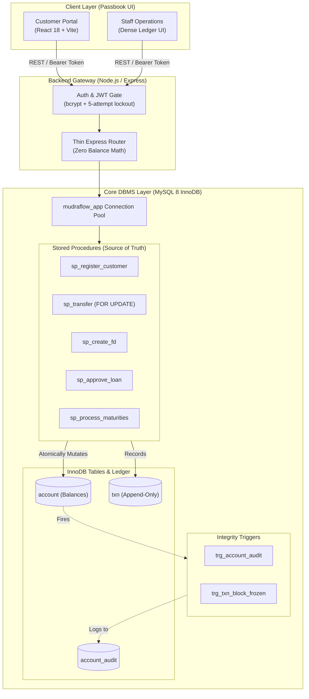

<div align="center">

# 🏛️ MudraFlow
### Enterprise-Grade Online Banking & Core DBMS Engine

*A secure, relational database–first core banking system engineered with **MySQL 8 (InnoDB)**, **Node.js (Express)**, and **React (Vite)**.*

[](https://www.mysql.com/)
[](https://nodejs.org/)
[](https://react.dev/)
[](https://vitejs.dev/)
[](LICENSE)

---

</div>

## 📌 Executive Summary

Most modern web applications execute financial invariants, interest calculations, and ledger updates in application-layer memory. In contrast, **MudraFlow** implements a **database-first architecture**:

> **The Database is the Star.** 
> All balances, transfers, loans, fixed deposits, and audit entries are strictly encapsulated inside **MySQL 8 stored procedures, deterministic functions, and triggers**.
> The application backend connects via a restricted runtime user (`mudraflow_app`) that possesses **zero** `UPDATE` permission on account balances. It is mathematically impossible for application bugs or SQL injections to tamper with balances directly.

---

## 📸 Visual Showcase

<div align="center">
  <table>
    <tr>
      <td width="50%" align="center">
        <b>Customer Passbook Dashboard (1280px Desktop)</b><br/>
        
      </td>
      <td width="50%" align="center">
        <b>Staff Core Operations Portal</b><br/>
        
      </td>
    </tr>
    <tr>
      <td width="50%" align="center">
        <b>Atomic Transfer Slip & Live Review</b><br/>
        
      </td>
      <td width="50%" align="center">
        <b>Official Transaction Slip (Print-Ready)</b><br/>
        
      </td>
    </tr>
  </table>
</div>

---

## ⚡ Key Technical Highlights

### 🛡️ 1. Least Privilege Database Security
The application connects exclusively through MySQL user `mudraflow_app`:
```sql
-- Runtime user grant policy (db/01_schema.sql)
GRANT SELECT ON mudraflow.* TO 'mudraflow_app'@'localhost';
GRANT EXECUTE ON mudraflow.* TO 'mudraflow_app'@'localhost';
-- NOTICE: Zero UPDATE/DELETE privileges on financial tables!
```

### 🔒 2. Pessimistic Concurrency & Deadlock Avoidance
To prevent race conditions when two concurrent transfers target the same funds, `sp_transfer` acquires locks using `SELECT ... FOR UPDATE` ordered strictly by `account_id` ascending:
```sql
-- Ordered row lock acquisition ensures zero circular wait deadlocks
SELECT balance INTO v_from_balance FROM account 
WHERE account_id = LEAST(p_from_acc, p_to_acc) FOR UPDATE;

SELECT balance INTO v_to_balance FROM account 
WHERE account_id = GREATEST(p_from_acc, p_to_acc) FOR UPDATE;
```
> **Concurrency Guarantee:** When two ₹8,000 transfers attempt to debit a ₹10,000 account at the same millisecond, exactly one succeeds; the second rolls back safely with `Insufficient balance`. The balance **never** drops below zero.

### 📜 3. Regulatory Audit Logging & Freeze Protection
- **Trigger `trg_account_audit`:** Automatically logs every status transition (ACTIVE $\leftrightarrow$ FROZEN) and balance shift to an append-only audit ledger (`account_audit`).
- **Trigger `trg_txn_block_frozen`:** Database-level gatekeeper that rejects any debit or credit attempted against a frozen account.

### 🚀 4. Composite B-Tree Index Optimization
Tested over 50,000 ledger rows (`db/tests/explain.sql`):
- **Full Table Scan (Without Index):** Examined **50,000 rows** + disk `filesort`.
- **Composite Index `(from_account_id, created_at)`:** Examined **112 rows** (**446x speedup**) with reverse B-Tree scan, eliminating `filesort` entirely.

---

## 🛠️ System Architecture



---

## 📂 Project Structure

```text
mudraflow/
├── db/                       # Database Source of Truth
│   ├── 01_schema.sql         # 10 Tables, Constraints, CHECKs, Users & Grants
│   ├── 02_programs.sql       # Stored Procedures, Functions, Triggers, Views
│   ├── seed.js               # Database seeding script (bcrypt-hashed passwords)
│   └── tests/                # Concurrency (D2) & EXPLAIN (D4) benchmarks
├── backend/                  # Thin Express API Layer
│   ├── server.js             # API entry point & error handler
│   ├── db.js                 # MySQL2 connection pool (mudraflow_app)
│   ├── middleware/           # Role-based JWT authentication
│   ├── routes/               # auth.js, customer.js, staff.js
│   └── tests/                # Automated gate test suite (12/12 passing)
├── frontend/                 # React 18 + Vite Passbook UI
│   ├── src/components/       # AppShell, LedgerTable, Slip, Drawers, Modals
│   ├── src/pages/customer/   # Home, Transfer, Payees, History, FD, Services
│   ├── src/pages/staff/      # Overview, Approvals, Customers, Transactions, FDs
│   ├── src/styles/           # Design tokens, responsive styles, print.css
│   └── tests/                # Currency formatters & amount in words tests
├── spec/                     # System specifications (01 through 07)
└── docs/                     # Presentation demo script & EXPLAIN benchmarks
```

---

## 🚦 Getting Started

### Prerequisites
- **MySQL Server 8.0+** running locally
- **Node.js 18+** & **npm 9+**
- **Git**

---

### Step 1: Clone Repository & Install Dependencies

```bash
# Clone the repository
git clone https://github.com/Kushagra-Mittal-07/MudraFlow.git
cd MudraFlow

# Install backend dependencies
cd backend && npm install

# Install frontend dependencies
cd ../frontend && npm install
cd ..
```

---

### Step 2: Configure Environment Variables

Create `.env` in the root folder and in `backend/.env`:

```env
# Database Credentials
DB_HOST=localhost
DB_PORT=3306
DB_NAME=mudraflow
DB_USER=mudraflow_app
DB_PASSWORD=MudraAppPass@123

# Admin credentials for schema creation & testing
DB_ADMIN_USER=root
DB_ADMIN_PASSWORD=your_mysql_root_password

# Application Settings
PORT=3000
JWT_SECRET=mudraflow_super_secret_jwt_key_change_in_production
NODE_ENV=development
```

---

### Step 3: Initialize MySQL Database & Run Seed Script

Execute the SQL scripts in order using MySQL client:

```bash
# 1. Initialize schema, tables, and least-privilege users
mysql -u root -p < db/01_schema.sql

# 2. Deploy stored procedures, deterministic functions, and triggers
mysql -u root -p < db/02_programs.sql

# 3. Populate database with seed customers, accounts, and ledger entries
node db/seed.js
```

---

### Step 4: Run the Application

In your first terminal, start the **Backend API**:
```bash
cd backend
node server.js
# API running at http://localhost:3000
```

In your second terminal, start the **Frontend UI**:
```bash
cd frontend
npm run dev
# Web app running at http://localhost:5173
```

Navigate to `http://localhost:5173` in your browser.

---

## 🔑 Demo Credentials

| Role | Username / ID | Password | Demo OTP | Description |
|---|---|---|---|---|
| **Customer** | `10000001` *(Aarav Patel)* | `Password@123` | `123456` | Active Savings & Current accounts |
| **Customer** | `10000002` *(Priya Verma)* | `Password@123` | `123456` | Beneficiary for instant transfers |
| **Customer** | `10000003` *(Rahul Sharma)* | `Password@123` | `123456` | Has active and matured fixed deposits |
| **Staff** | `1` *(or `EMP001`)* | `StaffPassword@123` | N/A | Bank Officer with approval privileges |

---

## 🧪 Automated Test Suites & Verification

MudraFlow includes comprehensive verification across database, API, and UI layers:

```bash
# 1. Frontend Unit Tests (7/7 tests passed)
npm test --prefix frontend

# 2. Backend API Gate Tests (12/12 tests passed)
node backend/tests/api-tests.js

# 3. Concurrency Test D2 (Pessimistic row locking verification)
node db/tests/concurrency.js

# 4. Production Frontend Build (0 errors)
npm run build --prefix frontend
```

---

## 🎓 8-Minute Presentation Script & Viva Walkthrough

A complete, minute-by-minute presentation guide for viva examiners is available at [`docs/demo-script.md`](docs/demo-script.md), covering:
1. Architectural defense of database-level balance encapsulation
2. End-to-end customer registration & verification
3. Atomic funds transfer and print-ready receipts
4. Live terminal concurrency demonstration
5. Fixed deposit calculations and staff loan credit workflows
6. MySQL `EXPLAIN` query plan analysis

---

## 📄 License & Authors

- **Author:** [Kushagra Mittal](https://github.com/Kushagra-Mittal-07)
- **Project:** MudraFlow Core Banking Engine (DBMS Project)
- **License:** Open-source under the [MIT License](LICENSE).
